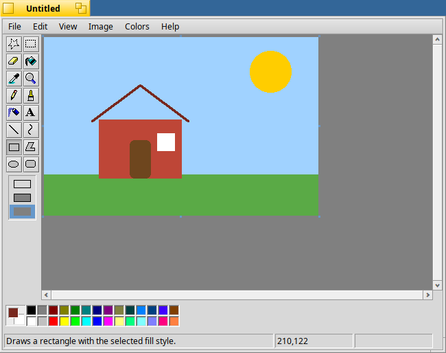
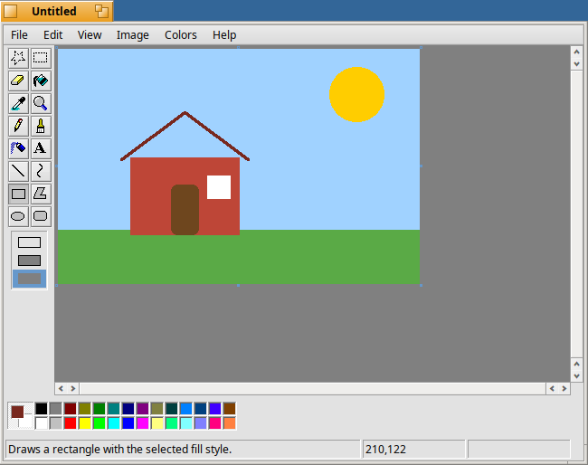
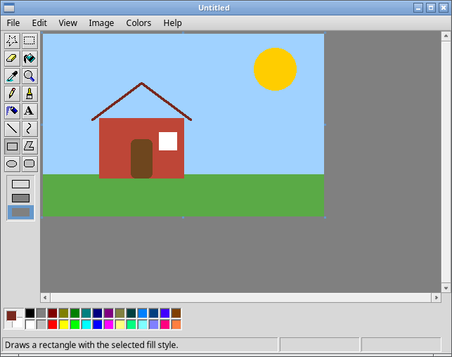

PowerPaint
==========

PowerPaint is a native Haiku port of [JS Paint](https://github.com/1j01/jspaint),
Isaiah Odhner's web remake of MS Paint. It is written in C++ against the
Haiku API (no browser, no web runtime), keeps JS Paint's layout, tools and
sizes, and follows Haiku's conventions for menus, shortcuts and alerts.

Platforms
---------

| Platform | Package | Status |
|---|---|---|
| Haiku R1/beta6 and Renku OS, x86_64 | `.hpkg` | not yet tested for this release |
| Renku OS, arm64 | `.hpkg` | not yet tested for this release |
| VitruvianOS (V\OS, a BeOS-like OS based on Linux), amd64 and arm64 | `.deb` | not yet tested for this release |
| Linux (X11 and Wayland, through [Hokku](https://github.com/idumych/hokku)), x86_64 and aarch64 | AppImage | not yet tested for this release |

On V\OS, About PowerPaint opens V\OS's own about window; on Haiku and Linux
it is an alert.

Features
--------

- **All sixteen tools**, in MS Paint's tool box: free-form select, select,
  eraser/color eraser, fill with color, pick color, magnifier, pencil, brush,
  airbrush, text, line, curve, rectangle, polygon, ellipse and rounded
  rectangle. The primary button draws in the foreground colour, the
  secondary button in the background colour. Shift makes squares and
  circles, and snaps lines to 45°.
- **Tool options** under the tool box, as in MS Paint: 12 brush shapes,
  4 eraser sizes, 3 airbrush sizes, 5 line widths, 3 fill styles, zoom levels,
  and opaque or transparent selections and text.
- **Selections** can be moved, resized by their eight handles, copied with
  Ctrl-drag, smeared with Shift-drag, nudged with the arrow keys, cut, copied,
  pasted, deleted, saved with Copy to… and loaded with Paste from….
- **Image menu:** flip and rotate (by 90°, 180°, 270° or any angle),
  stretch and skew, invert colors, attributes (picture size), clear image,
  draw opaque. They work on the selection if there is one.
- **The picture** can be resized by dragging the handles at its right and
  bottom edges, zoomed from 100% to 1000%, with a pixel grid from 400%, and
  shown alone full screen (View bitmap).
- **Colors:** JS Paint's 28-colour palette; double-click a swatch to edit it,
  and load or save palettes (GIMP `.gpl`, RIFF and JASC `.pal`).
- **Text tool** with a Fonts toolbar (family, size, bold, italic,
  underline), drawn without anti-aliasing like MS Paint's.
- **Files:** opens and saves every format Haiku's translators handle; the
  format comes from the file's type or its extension, PNG otherwise.
  Recent files, drag and drop from Tracker, and the system clipboard
  (`image/bitmap`, as ShowImage uses).
- Pictures of up to 67 million pixels (8192 × 8192); larger sizes are refused
  with a message instead of exhausting Haiku's memory.
- Undo and redo, and the tool, colours, palette, options and window frame are
  remembered between runs.

Screenshots
-----------

The same picture, drawn with PowerPaint's own tools (fill, rectangles, an ellipse,
a rounded rectangle and lines), the Rectangle tool selected with its fill styles:

Haiku R1/beta6.

VitruvianOS 0.6.3.

Linux (X11, Openbox), from the AppImage.

What's different from JS Paint
------------------------------

- One window per picture, as is usual on Haiku; opening a file from Tracker
  or the command line adds a window to the running app.
- Menus and labels in Haiku's sentence case. About is in the Help menu;
  Close and Quit are in File.
- Shortcuts use Haiku's command key (Alt): New, Open, Save, Save as (Alt+Shift+S),
  Close (Alt+W), Quit, Undo (Alt+Z), Redo (Alt+Shift+Z), Cut, Copy, Paste,
  Select all, Tool box (Alt+T), Color box (Alt+L), Flip/rotate (Alt+R),
  Invert colors (Alt+I), Attributes (Alt+E), Normal and large size
  (Alt+Page up/down). Where JS Paint's shortcut is one Haiku reserves, it
  moved: Show grid is Alt+Shift+G (Alt+G is Find again), View bitmap
  Alt+Shift+F (Alt+F is Find), Clear image Alt+Shift+N, and Stretch/skew has
  none (Alt+W closes the window).
- The zoom levels are listed in View ▸ Zoom (100% to 1000%) instead of a
  Custom zoom dialog.
- Tool buttons, dialogs and the Edit colors window use Haiku's controls.
- Undo is a simple list; JS Paint's history tree isn't ported.
- Attributes sets the size in pixels only, without units or the black and
  white mode.

Not ported (yet): help topics, the history tree, multi-user sessions, eye
gaze and head tracking, speech recognition, themes, printing, setting the
desktop background, load from URL and upload to Imgur, the thumbnail,
"draw randomly", the vertical colour box, and translations (strings are marked
for translation, but there are no catalogs).

Building
--------

On Haiku, with `gcc`, `make` and `haiku_devel`:

    make            # ./PowerPaint
    make test       # unit tests of the drawing core; run on any OS
    sh tests/smoke.sh   # drives the app itself through --do (quit it first)
    make install    # into ~/config/non-packaged/apps

On VitruvianOS, `make` with its development headers (`pkg-config vos`, or
`/system/develop/headers`); release `.deb`s are built in CI against a
link-time V\OS SDK (`tools/vos-sdk/`, `.github/workflows/deb.yml`). On other
Linux systems, `make COSMOE_ROOT=<prefix>` with Hokku installed there; release
AppImages come from `.github/workflows/appimage.yml`.

On another OS, `sh tools/haiku-typecheck.sh` checks the Haiku code against
Haiku's headers without building it.

Layout of the source:

- `src/core/` — the drawing core, plain C++ with no Haiku headers: the pixel
  buffer, MS Paint's aliased lines, brushes, shapes, polygons and curves, the
  flood fill, the airbrush, transforms and palette files. Tested by
  `tests/RasterTest.cpp`.
- `src/ui/` — the Haiku application: the window, canvas, tool box, colour
  box, status bar, dialogs and the Fonts toolbar.
- `images/` — tool icons and pointers from JS Paint.
- `tools/make-icon.py` — writes the app's vector icon into the `.rdef`.
- `src/ui/vos/AboutWindow.h` — a copy of V\OS's private `BAboutWindow` header
  (MIT, Haiku, Inc.), used only in V\OS builds: V\OS's SDK leaves out its
  private headers.
- `packaging/`, `release/test-plan.md` — packages for every platform and how
  each release is tested.

Testing
-------

For tests without a mouse, PowerPaint runs commands given with `--do`
(or sent to a running copy the same way, since it is single-launch), and
prints each one and its result:

    PowerPaint --do "tool pencil; fg 255 0 0; drag 10 10 100 50; dump; save /tmp/t.png"

Commands, separated by `;`: `tool NAME|NUMBER`, `fg R G B`, `bg R G B`,
`set brushShape|brushSize|eraserSize|airbrushSize|strokeSize|fillStyle|transparent|fontSize N`,
`down|move|up|click|dclick X Y [right] [shift] [ctrl]`,
`drag X1 Y1 X2 Y2 [right] [shift] [ctrl]`, `type TEXT`,
`key esc|del|enter|backspace`, `zoom N`, `grid on|off`,
`send CODE field=value…` (any window message, e.g. `send datt width=200 height=100`),
`open PATH`, `save PATH`, `dump`, `pixel X Y`, `colors` and `discard`
(forget changes, so the window closes without asking). Coordinates are
picture pixels.

License
-------

MIT, like JS Paint; see [LICENSE](LICENSE). The tool icons and pointers in
`images/` are JS Paint's.
